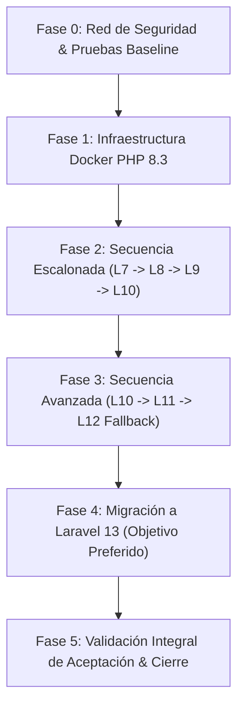

# Bridges Note: Plan de Migración a PHP 8.3 y Laravel Compatible

## 1. Baseline Actual del Repositorio (Basado en Código y Dependencias)

A diferencia de las asunciones generales descritas en el archivo `README.md` (que menciona compatibilidad con PHP 7.4/8.0 y un entorno local en Laragon/XAMPP), la inspección estricta de los archivos del repositorio revela el siguiente estado técnico real:

### 1.1. Versiones de Lenguaje y Framework
- **PHP:** Configurado en `composer.json` como `"php": "^7.2.5|^8.0"`. En `composer.lock`, el proyecto está resuelto sin platform-overrides explícitos, pero la combinación de dependencias bloquea la ejecución en PHP 8.1+ debido a incompatibilidades de tipo en `ArrayAccess` y dependencias de Symfony 5.4.
- **Laravel Framework:** Declarado como `"laravel/framework": "^7.29"` en `composer.json` y fijado exactamente en **`v7.30.7`** en `composer.lock`.

### 1.2. Árbol de Dependencias Directas y Bloqueos
| Paquete | Versión `composer.json` | Versión `composer.lock` | Estado respecto a PHP 8.3 |
| :--- | :--- | :--- | :--- |
| `laravel/framework` | `^7.29` | `v7.30.7` | **Incompatible** (Soporta max PHP 8.0.x). EOL desde marzo de 2021. |
| `fideloper/proxy` | `^4.4` | `4.4.2` | **Obsoleto / Abandonado**. Reemplazado en Laravel 9+ por middleware nativo. |
| `fruitcake/laravel-cors` | `^2.0` | `v2.2.0` | **Obsoleto / Abandonado**. Reemplazado en Laravel 9.2+ por middleware nativo. |
| `guzzlehttp/guzzle` | `^6.3.1\|^7.0.1` | `7.9.2` | Compatible con PHP 8.3 en rama 7.x, pero atado a restricciones de Laravel 7. |
| `laravel/tinker` | `^2.5` | `v2.10.0` | Requiere actualización menor a `^2.9`+. |
| `facade/ignition` (dev) | `^2.0` | `2.17.7` | **Incompatible / Abandonado**. Reemplazado en Laravel 9+ por `spatie/laravel-ignition`. |
| `fakerphp/faker` (dev) | `^1.9.1` | `v1.24.1` | Compatible con PHP 8.3. |
| `mockery/mockery` (dev) | `^1.3.1` | `1.6.12` | Requiere `^1.6` para compatibilidad total con PHP 8.3. |
| `nunomaduro/collision` (dev) | `^4.3` | `v4.3.0` | **Incompatible con PHP 8.3**. Requiere actualización correspondiente a la versión mayor de Laravel. |
| `phpunit/phpunit` (dev) | `^8.5.8\|^9.3.3` | `9.6.22` | PHPUnit 9.6 soporta PHP 8.3 transicionalmente; versiones modernas de Laravel estandarizan PHPUnit 10+. |
| `swiftmailer/swiftmailer` (transitiva) | Transición v6 | `v6.3.0` | **Abandonado**. Laravel 9+ migró a `symfony/mailer`. |
| `league/flysystem` (transitiva) | Transición v1 | `1.1.10` | **Incompatible con PHP 8.3**. Laravel 9+ migró a Flysystem 3.x. |

### 1.3. Estructura y Particularidades Arquitectónicas del Repositorio
1. **Directorio Raíz Aplanado (Webroot Anómalo):**
   - No existe la carpeta `public/` estándar de Laravel.
   - El archivo frontal `index.php` está ubicado directamente en la raíz del repositorio (`brigesnote/index.php`), conteniendo `require __DIR__.'/vendor/autoload.php'` y `require_once __DIR__.'/bootstrap/app.php'`.
   - `.htaccess`, `favicon.ico`, `robots.txt` y `server.php` residen en la raíz.
   - `server.php` contiene código original que intenta cargar `__DIR__.'/public/index.php'`, lo cual fallaría con el servidor de desarrollo integrado si no se ejecuta mediante `artisan serve`.
   - *Riesgo de seguridad:* Si un servidor web expone la raíz como DocumentRoot, archivos confidenciales (`.env`, `composer.json`, `.git/`) quedarían expuestos si el servidor no cuenta con reglas estrictas de bloqueo.
2. **Ubicación y Estado de Modelos:**
   - Los modelos de dominio están en `app/Models/` (`District.php`, `Province.php`, `Region.php`, `School.php`), todos configurados con claves primarias alfanuméricas (`$incrementing = false; protected $keyType = 'string';`).
   - Importan `use Illuminate\Database\Eloquent\Factories\HasFactory;` pero no usan el trait dentro de la clase.
   - Existe un archivo huérfano `app/Region.php` (clase vacía en namespace `App`) que no se utiliza en ninguna ruta ni controlador.
   - El modelo de usuario está en `app/User.php` (namespace `App`), mientras que la convención moderna de Laravel los ubica en `App\Models\User`.
3. **Controladores y Consultas SQL Crudas:**
   - `LocationController.php` utiliza la función SQL `LEFT(idProvincia, 2)` y `LEFT(idDistrito, 4)` mediante `whereRaw()`. Esta función es nativa de MySQL/MariaDB, pero no existe de forma predeterminada en SQLite, lo cual condiciona la estrategia de pruebas unitarias.
4. **Comando de Consola Artisan:**
   - `app/Console/Commands/SyncLocations.php` (`sync:locations`) implementa llamadas HTTP secuenciales al API oficial de MINEDU/ESCALE usando `Illuminate\Support\Facades\Http`.
   - `app/Http/Kernel.php` tiene una propiedad residual `protected $commands = [ Commands\SyncLocations::class ];` que no pertenece al Kernel HTTP (sino a Console Kernel).
5. **Autoloading y Fábricas:**
   - `composer.json` autoload classmap incluye `"database/seeds"` y `"database/factories"` (nomenclatura Laravel 7). Laravel 8+ estandarizó PSR-4 en `Database\\Seeders\\` y `Database\\Factories\\`.
6. **Estado de Pruebas:**
   - Solo existen los esqueletos por defecto `tests/Feature/ExampleTest.php` y `tests/Unit/ExampleTest.php`.
   - **No existen pruebas unitarias ni de integración para `LocationController` ni para `SyncLocations`.**
   - En `phpunit.xml`, las variables de entorno para base de datos SQLite en memoria (`DB_CONNECTION=sqlite`, `DB_DATABASE=:memory:`) se encuentran comentadas.

---

## 2. Versión Objetivo Propuesta: PHP 8.3 y Laravel

### 2.1. Target Propuesto Explícito
- **Objetivo Preferido:** **PHP 8.3 con Laravel 13**.
  - **Justificación:** Laravel 13 soporta PHP 8.3 de forma nativa, asegurando la máxima vigencia tecnológica y soporte a largo plazo para este microservicio.
  - **Condición Estricta:** Esta meta se establece **condicionada a la verificación práctica de las dependencias de Composer del repositorio y a la resolución exitosa de cualquier bloqueador** durante la ejecución escalonada. En esta fase de planificación no se modifican `composer.json` ni `composer.lock`.
- **Fallback Documentado:** **Laravel 12**.
  - Si durante la resolución técnica de dependencias o actualización de contratos Laravel 13 no pudiera alcanzarse sin cambios inaceptables en dependencias de terceros o en el código de la aplicación, el equipo se detendrá en **Laravel 12** como versión estable de contingencia, la cual también soporta PHP 8.3.

### 2.2. Matriz de Compatibilidad de Versiones
| Versión Laravel | Soporte PHP | Rol en el Proceso de Migración |
| :--- | :--- | :--- |
| **Laravel 7** | 7.2 - 8.0 | **Línea base actual.** Incompatible con PHP 8.3. |
| **Laravel 8** | 7.3 - 8.1 | Paso intermedio del upgrade path. |
| **Laravel 9** | 8.0 - 8.2 | Paso intermedio del upgrade path (reemplazo de dependencias obsoletas). |
| **Laravel 10** | 8.1 - 8.3 | Paso intermedio del upgrade path (primer punto con soporte PHP 8.3). |
| **Laravel 11** | 8.2 - 8.3 (+ 8.4) | Paso intermedio del upgrade path (modernización de estructura). |
| **Laravel 12** | 8.2 - 8.3 (+ 8.4) | **Fallback Documentado**. Versión de contingencia si surgen bloqueadores en L13. |
| **Laravel 13** | **8.3+** | **Objetivo Preferido Propuesto** (condicionado a verificación de Composer). |

### 2.3. Principio de Actualización Escalonada sin Despliegues Intermedios a Producción
- **Filosofía del Proceso:** El equipo **debe seguir rigurosamente las guías oficiales de actualización por versión mayor de Laravel** (`Upgrade Guides`), verificando la compatibilidad de código y dependencias en cada etapa (7 -> 8 -> 9 -> 10 -> 11 -> 12 -> 13).
- **Aclaración Crucial sobre Despliegue:** Seguir la secuencia completa de versiones mayores es un requerimiento técnico del gestor de dependencias (Composer) y de la evolución de contratos internos del framework. **Esto NO significa que cada versión intermedia deba ser desplegada en producción ni que deban generarse releases de producción separados por cada versión**. Toda la secuencia se ejecuta y valida progresivamente en el entorno de desarrollo y pruebas dentro de la rama de migración, desplegando únicamente la versión final aprobada (Laravel 13 preferida o Laravel 12 fallback).

---

## 3. Secuencia de Actualización de Dependencias y Áreas de Ruptura (Breaking Changes)

### 3.1. Matriz de Reemplazo y Evolución de Dependencias
```
[Laravel 7.30]                           [Laravel Moderno: 10 -> 13]
fideloper/proxy: ^4.4        --->        Illuminate\Http\Middleware\TrustProxies (nativo en L9+)
fruitcake/laravel-cors: ^2.0 --->        Illuminate\Http\Middleware\HandleCors (nativo en L9.2+)
facade/ignition: ^2.0        --->        spatie/laravel-ignition (dev)
swiftmailer/swiftmailer      --->        symfony/mailer
league/flysystem: ^1.1       --->        league/flysystem: ^3.0
nunomaduro/collision: ^4.3   --->        nunomaduro/collision (actualizado por versión mayor)
phpunit/phpunit: ^9.3        --->        phpunit/phpunit: ^10.0 / ^11.0
laravel/tinker: ^2.5         --->        laravel/tinker: ^2.9+
```

### 3.2. Ruta Escalonada de Composer (7.x a 13.x)
Cada etapa requiere consultar la guía oficial de migración de Laravel correspondiente y ejecutar las pruebas automatizadas del proyecto:

1. **Paso 1: Laravel 7.x a 8.x**
   - Actualizar `laravel/framework: ^8.83`, `nunomaduro/collision: ^5.10`, `facade/ignition: ^2.5`.
   - Ajustar `app/Http/Middleware/RedirectIfAuthenticated.php` para la firma con `...$guards`.
   - Estandarizar namespace de seeders si aplica (`Database\Seeders`).
2. **Paso 2: Laravel 8.x a 9.x**
   - Actualizar a `laravel/framework: ^9.52`.
   - Eliminar `fideloper/proxy` y actualizar `TrustProxies.php` para heredar de `Illuminate\Http\Middleware\TrustProxies`.
   - Eliminar `fruitcake/laravel-cors` y adoptar `Illuminate\Http\Middleware\HandleCors`.
   - Reemplazar `facade/ignition` por `spatie/laravel-ignition`.
   - Transición de SwiftMailer a Symfony Mailer y Flysystem 1 a Flysystem 3.
3. **Paso 3: Laravel 9.x a 10.x**
   - Actualizar a `laravel/framework: ^10.0`, `nunomaduro/collision: ^7.0`, `phpunit/phpunit: ^10.0`.
   - Actualizar esquema de `phpunit.xml` (reemplazo de `<filter><whitelist>` por `<source><include>`).
   - Validar ejecución en runtime de PHP 8.3 (primer hito compatible con PHP 8.3).
4. **Paso 4: Laravel 10.x a 11.x**
   - Actualizar a `laravel/framework: ^11.0`, `nunomaduro/collision: ^8.0`.
   - Evaluar adopción de la estructura simplificada de configuración en `bootstrap/app.php` o mantener compatibilidad con los kernels existentes.
5. **Paso 5: Laravel 11.x a 12.x (Punto de Fallback Documentado)**
   - Actualizar dependencias según la guía oficial de Laravel 12.
   - Ejecutar la suite completa de pruebas unitarias y de integración.
   - Si se presentan incompatibilidades de dependencias de terceros para Laravel 13 que requieran reescrituras complejas o inaceptables, **este es el punto de congelamiento y entrega (Fallback)**.
6. **Paso 6: Laravel 12.x a 13.x (Objetivo Preferido)**
   - Actualizar a `laravel/framework: ^13.0` y dependencias compatibles.
   - Verificar ausencia de advertencias de deprecación o conflictos en Composer.
   - Ejecutar suite completa de validación de contrato.

---

## 4. Verificación y Preservación del Contrato de la API

La API sirve a sistemas externos de admisión y matrículas escolares. Es un requisito inmutable preservar paths, métodos, parámetros, status codes y la estructura JSON de respuesta.

### 4.1. Catálogo Exacto de Endpoints y Contratos

#### Endpoint 1: Listado de Regiones
- **Ruta:** `GET /api/regiones`
- **Controlador / Método:** `LocationController@getRegions`
- **Query / DB:** `Region::all()`
- **Parámetros:** Ninguno
- **Status Exitoso:** `200 OK`
- **Estructura JSON (Preservar estrictamente):**
  ```json
  {
    "status": "success",
    "data": [
      {
        "idRegion": "15",
        "nombreRegion": "LIMA",
        "pointX": -12.046374,
        "pointY": -77.042793,
        "zoom": 10,
        "created_at": "...",
        "updated_at": "..."
      }
    ]
  }
  ```

#### Endpoint 2: Provincias por Región
- **Ruta:** `GET /api/provincias/{idRegion}`
- **Controlador / Método:** `LocationController@getProvinces($idRegion)`
- **Query / DB:** `Province::whereRaw('LEFT(idProvincia, 2) = ?', [$idRegion])->get()`
- **Parámetros de Ruta:** `{idRegion}` (ej. `15`)
- **Status Exitoso:** `200 OK`
  ```json
  {
    "status": "success",
    "data": [
      {
        "idProvincia": "1501",
        "nombreProvincia": "LIMA",
        "pointX": -12.046374,
        "pointY": -77.042793,
        "created_at": "...",
        "updated_at": "..."
      }
    ]
  }
  ```
- **Status No Encontrado:** `404 Not Found` (cuando la colección está vacía)
  ```json
  {
    "status": "error",
    "message": "No se encontraron provincias para esta región."
  }
  ```

#### Endpoint 3: Distritos por Provincia
- **Ruta:** `GET /api/distritos/{idProvince}`
- **Controlador / Método:** `LocationController@getDistricts($idProvince)`
- **Query / DB:** `District::whereRaw('LEFT(idDistrito, 4) = ?', [$idProvince])->get()`
- **Parámetros de Ruta:** `{idProvince}` (ej. `1501`)
- **Status Exitoso:** `200 OK`
  ```json
  {
    "status": "success",
    "data": [
      {
        "idDistrito": "150101",
        "nombreDistrito": "LIMA",
        "created_at": "...",
        "updated_at": "..."
      }
    ]
  }
  ```
- **Status No Encontrado:** `404 Not Found`
  ```json
  {
    "status": "error",
    "message": "No se encontraron distritos para esta provincia."
  }
  ```

#### Endpoint 4: Colegios por Distrito (Ubigeo)
- **Ruta:** `GET /api/colegios/{ubigeo}`
- **Controlador / Método:** `LocationController@getSchools($districtId)`
- **Query / DB:** `School::where('idDistrito', $districtId)->get()`
- **Parámetros de Ruta:** `{ubigeo}` (mapeado al parámetro `$districtId`)
- **Status Exitoso:** `200 OK`
  ```json
  {
    "status": "success",
    "data": [
      {
        "codMod": "0273572",
        "idDistrito": "150101",
        "nombreCenEdu": "JUAN JIMENEZ PIMENTEL",
        "cenPob": "LIMA",
        "dirCen": "JR. LAMPA 240",
        "director": "PEDRO PEREZ",
        "dis_crecer": null,
        "dis_juntos": null,
        "created_at": "...",
        "updated_at": "..."
      }
    ]
  }
  ```
- **Status No Encontrado:** `404 Not Found`
  ```json
  {
    "status": "error",
    "message": "No se encontraron escuelas para este distrito."
  }
  ```

### 4.2. Especificación OpenAPI 3.0 Contract Baseline
Se redactará un archivo de contrato OpenAPI `docs/openapi.yaml` durante la fase de aseguramiento para verificar mediante pruebas automatizadas que ninguna cabecera, payload o código de retorno sufra alteraciones.

---

## 5. MySQL, Migraciones y Verificación de Codificación

### 5.1. Configuración de Base de Datos
- **Motor:** MySQL / MariaDB (InnoDB). En `config/database.php`: `'engine' => null` (por defecto del servidor MySQL, típicamente `InnoDB`). **No se debe modificar el motor.**
- **Conjunto de Caracteres y Cotejamiento:**
  - `'charset' => 'utf8mb4'`
  - `'collation' => 'utf8mb4_unicode_ci'`
  - Mantener exactamente estos valores para soportar acentos, diéresis y caracteres especiales de topónimos peruanos (ej. *Áncash*, *Junín*, *Víctor Larco Herrera*).

### 5.2. Evaluación de Tablas y Esquemas
Las 4 migraciones de dominio existentes son:
1. `2024_12_22_010708_create_regions_table.php`: Clave primaria `string('idRegion')`.
2. `2024_12_22_010930_create_provinces_table.php`: Clave primaria `string('idProvincia')`.
3. `2024_12_22_011019_create_districts_table.php`: Clave primaria `string('idDistrito')`.
4. `2024_12_22_011120_create_schools_table.php`: Clave primaria `string('codMod')`, índice en `string('idDistrito')->index()`.

**Regla de preservación de datos:**
- No se deben alterar los tipos de columnas ni eliminar tablas existentes.
- Las migraciones actuales utilizan clases tradicionales (`class CreateRegionsTable extends Migration`). En Laravel 8.37+ se introdujeron las migraciones anónimas (`return new class extends Migration`). Las migraciones existentes deben preservarse tal como están para no alterar la tabla interna `migrations`.

---

## 6. Estrategia de Pruebas (Test Strategy)

Dado que el repositorio carece actualmente de pruebas para sus funcionalidades nucleares, la migración exige implementar una red de seguridad antes y durante los upgrades.

### 6.1. Pruebas de Endpoints de la API (`LocationControllerTest`)
Se deben crear pruebas de características (`Feature Tests`) que validen:
1. `test_get_regions_returns_successful_data()`
2. `test_get_provincias_by_region_returns_data()`
3. `test_get_provincias_by_invalid_region_returns_404_error_message()`
4. `test_get_distritos_by_province_returns_data()`
5. `test_get_distritos_by_invalid_province_returns_404_error_message()`
6. `test_get_schools_by_district_ubigeo_returns_data()`
7. `test_get_schools_by_invalid_district_returns_404_error_message()`

### 6.2. Motor de Base de Datos para Pruebas: Desafío de `LEFT()`
- `LocationController` ejecuta `LEFT(idProvincia, 2)` y `LEFT(idDistrito, 4)`.
- Si se ejecutan pruebas con SQLite en memoria (`:memory:`), SQLite arrojará: `General error: 1 no such function: LEFT`.
- **Solución técnica para pruebas:**
  - *Opción A (Recomendada para CI local/rápido):* En el método `setUp()` de las pruebas que utilicen SQLite, registrar la función definida por el usuario:
    ```php
    if (DB::connection()->getDriverName() === 'sqlite') {
        DB::connection()->getPdo()->sqliteCreateFunction('LEFT', function ($string, $length) {
            return substr($string, 0, $length);
        });
    }
    ```
  - *Opción B (Recomendada para Docker/Staging):* Ejecutar la suite de pruebas contra un contenedor real de MySQL 8.0 con base de datos `escalebridge_test`.

### 6.3. Estrategia de Pruebas Segura para `SyncLocations` (Sin Conexión a MINEDU/ESCALE)
- **Principio Mandatorio:** Bajo ninguna circunstancia las pruebas unitarias o de integración deben conectarse a los servidores del MINEDU (`https://escale.minedu.gob.pe`).
- **Implementación con `Http::fake()`:**
  Laravel provee el mockeo nativo de HTTP Client. Se crearán fixtures simulados que cubran las dos estructuras de respuesta detectadas en la inspección del código:
  1. **Respuesta en Lista (múltiples registros):** Cuando la API retorna arreglos de objetos.
  2. **Respuesta Objeto Único (caso de borde MINEDU):** `SyncLocations.php` tiene lógica especial para objetos únicos asociativos:
     - `isset($provinces['idProvincia'])`
     - `isset($districts['idDistrito'])`
     - `isset($schools['codMod'])`
  3. **Respuesta de Error / Falla HTTP:** Simular `Http::response(null, 500)` y verificar que el comando informa el error sin abortar abruptamente la aplicación ni corromper datos.

---

## 7. Cambios en Docker y Runtime para PHP 8.3

Actualmente el repositorio **no contiene Dockerfile ni docker-compose.yml**. Para estandarizar el runtime de PHP 8.3 sin depender de configuraciones del sistema operativo anfitrión, se requiere diseñar la siguiente infraestructura en contenedores:

### 7.1. Especificación del Contenedor de Aplicación (`Dockerfile`)
- **Imagen Base:** `php:8.3-fpm-alpine`
- **Extensiones PHP Requeridas:**
  - `pdo_mysql` (Conexión a base de datos MySQL)
  - `mbstring`, `openssl`, `tokenizer`, `xml`, `ctype`, `json`, `curl`, `zip`, `bcmath`
  - `opcache` (Optimización en producción)
- **Herramientas de CLI:** `composer:2` (multi-stage copy).

### 7.2. Servicios en `docker-compose.yml`
1. **`app`:** PHP 8.3-FPM con el código montado (desarrollo) o copiado (producción).
2. **`web`:** Nginx 1.25-alpine actuando como servidor web y proxy FastCGI hacia `app:9000`.
3. **`db`:** MySQL 8.0 configurado con:
   - `MYSQL_DATABASE=escalebridge`
   - `command: --character-set-server=utf8mb4 --collation-server=utf8mb4_unicode_ci`
   - Puerto `3306:3306`.

### 7.3. Manejo del Webroot y Seguridad del Servidor Web
- **Situación actual:** `index.php` está en la raíz (`/var/www/html/index.php`), sin carpeta `public/`.
- **Configuración de Nginx si se conserva la estructura actual:**
  El bloque de configuración del servidor debe restringir estrictamente el acceso a archivos de configuración y control de versiones:
  ```nginx
  server {
      listen 80;
      root /var/www/html;
      index index.php;

      # Bloquear acceso a archivos sensibles y directorios ocultos
      location ~ /\.(?!well-known).* {
          deny all;
      }
      location ~* /(composer\.(json|lock)|package\.json|phpunit\.xml|\.env.*|\.git.*) {
          deny all;
          return 404;
      }
      location /storage {
          # Restringir o permitir únicamente assets públicos si existiesen
      }

      location / {
          try_files $uri $uri/ /index.php?$query_string;
      }

      location ~ \.php$ {
          fastcgi_pass app:9000;
          fastcgi_param SCRIPT_FILENAME $document_root$fastcgi_script_name;
          include fastcgi_params;
      }
  }
  ```
- *Recomendación:* Crear una fase en la que se evalúe restaurar la carpeta estándar `public/` (creando un symlink o moviendo `index.php`, `.htaccess`, `robots.txt`, `favicon.ico`) para garantizar seguridad por diseño.

---

## 8. Fases de Implementación Ordenadas, Puntos de Retorno y Criterios de Aceptación



### Fase 0: Red de Seguridad y Congelamiento de Contrato (Pre-Upgrade)
- **Actividades:**
  1. Redactar las pruebas de integración en `tests/Feature/LocationControllerTest.php` contra la lógica actual.
  2. Implementar pruebas con `Http::fake()` para `SyncLocationsTest.php`.
  3. Ejecutar la suite (usando el mock SQLite o MySQL de prueba).
- **Punto de Retorno:** Tag git `baseline-pre-migration`.
- **Criterio de Aceptación:** Todas las pruebas del contrato de los 4 endpoints y del comando pasan al 100%.

### Fase 1: Entorno de Ejecución Docker con PHP 8.3
- **Actividades:**
  1. Crear `Dockerfile` (PHP 8.3-fpm) y `docker-compose.yml` (App, Nginx, MySQL 8).
  2. Configurar Nginx con reglas de protección para la raíz.
- **Punto de Retorno:** Revertir commits de infraestructura Docker sin afectar código.
- **Criterio de Aceptación:** `docker compose up -d` levanta los 3 contenedores sin errores y `php -v` dentro del contenedor reporta `PHP 8.3.x`.

### Fase 2: Actualización Escalonada de Framework (L7 -> L8 -> L9 -> L10)
- **Actividades:**
  - Seguir las guías oficiales de actualización paso a paso en el entorno de desarrollo.
  - Actualizar `composer.json` y dependencias compatibles en cada paso.
  - Registrar checkpoints internos (`checkpoint-laravel-8`, `checkpoint-laravel-9`, `checkpoint-laravel-10`).
  - *Nota:* Estas etapas no se despliegan a producción.
- **Punto de Retorno:** Checkpoint git de la versión previa.
- **Criterio de Aceptación:** `composer update` resuelve sin flags `--ignore-platform-reqs`, suite de pruebas en verde en cada versión mayor.

### Fase 3: Modernización y Validación en Laravel 11 y Laravel 12 (Fallback)
- **Actividades:**
  - Aplicar cambios de contratos y middleware correspondientes a Laravel 11 y Laravel 12.
  - Limpiar archivo huérfano `app/Region.php` y comandos residuales en `app/Http/Kernel.php`.
  - Normalizar `app/User.php` a `app/Models/User.php`.
  - Registrar tag `checkpoint-laravel-12-fallback`.
- **Punto de Retorno:** Checkpoint `checkpoint-laravel-10`.
- **Criterio de Aceptación:** Aplicación y pruebas 100% funcionales en Laravel 12 bajo PHP 8.3.

### Fase 4: Migración a Laravel 13 (Objetivo Preferido)
- **Actividades:**
  - Evaluar y resolver dependencias de Composer para `laravel/framework: ^13.0`.
  - Si existen bloqueadores de paquetes incompatibles que exijan cambios inaceptables, activar el **Fallback Laravel 12** y documentar las dependencias causantes.
  - Si la resolución es exitosa, aplicar guías de Laravel 13 y registrar tag `checkpoint-laravel-13-target`.
- **Punto de Retorno:** `git checkout checkpoint-laravel-12-fallback`.
- **Criterio de Aceptación:** Composer resuelve con éxito en Laravel 13 bajo PHP 8.3 con todas las pruebas automatizadas pasando al 100%.

### Fase 5: Validación Integral de Aceptación
- **Actividades:**
  1. Ejecución de suite completa de pruebas de contrato en contenedor Docker.
  2. Verificación estricta de status codes (200 y 404) y estructura JSON en `/api/regiones`, `/api/provincias/{id}`, `/api/distritos/{id}`, `/api/colegios/{ubigeo}`.
  3. Ejecución controlada de `php artisan sync:locations` en ambiente de pruebas aislado (con mock o staging verificado).
- **Criterios de Aceptación Finales:**
  - Contrato API 100% preservado sin alteración de endpoints, parámetros, métodos ni respuestas.
  - Cero advertencias de deprecación en PHP 8.3.
  - Repositorio limpio y listo para despliegue final en la versión seleccionada (L13 preferida o L12 fallback).

---

## 9. Preguntas Abiertas y Evidencia Faltante

Al inspeccionar estrictamente los archivos del repositorio, se identificaron los siguientes puntos que requieren confirmación con el propietario del repositorio antes o durante la fase de implementación:

1. **Estructura del Webroot (`public/` vs Raíz):**
   - *Hallazgo:* `index.php` está en la raíz del proyecto y no existe directorio `public/`.
   - *Pregunta:* ¿Esta estructura aplanada responde a un entorno de despliegue específico (por ejemplo, hosting compartido tipo cPanel sin configuración de DocumentRoot), o se debe normalizar a la convención estándar de Laravel (`public/index.php`) para mejorar la seguridad en contenedores Docker y servidores modernos?
2. **Ruta Autenticada Incompleta (`/user`):**
   - *Hallazgo:* En `routes/api.php` existe `Route::middleware('auth:api')->get('/user', ...)`. Sin embargo, en `composer.json` no está instalado Laravel Passport ni Laravel Sanctum, la migración de `users` no tiene columna `api_token`, y ningún endpoint del catálogo educativo requiere autenticación.
   - *Pregunta:* ¿Este endpoint es un remanente del scaffolding original de Laravel y debe eliminarse, o está previsto implementar autenticación con Sanctum en futuras fases?
3. **Archivo Huérfano `app/Region.php`:**
   - *Hallazgo:* Existe `app/Region.php` (clase vacía en namespace `App`) mientras que el modelo real utilizado por el controlador y el comando es `App\Models\Region`.
   - *Pregunta:* ¿Existe alguna referencia externa no versionada que dependa de `App\Region`, o se confirma su eliminación definitiva durante la limpieza?
4. **Resiliencia y Concurrencia de `sync:locations`:**
   - *Hallazgo:* El comando realiza más de 1,800 peticiones HTTP secuenciales directas a MINEDU. En versiones modernas de Laravel existen utilidades nativas como `Http::pool()` (peticiones concurrentes) y `Http::retry()`.
   - *Pregunta:* ¿Se desea conservar el comportamiento puramente secuencial actual, o se autoriza incorporar reintentos automáticos (`retry`) y manejo de excepciones de red sin alterar la lógica de negocio ni el esquema de datos?
